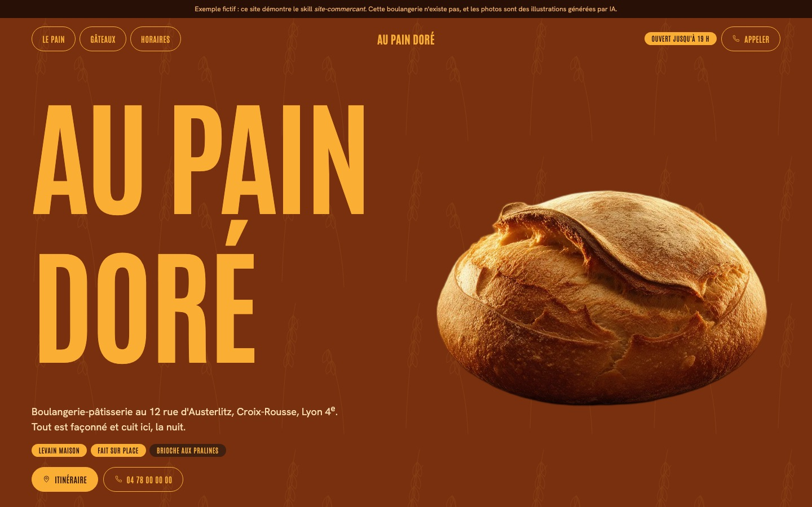
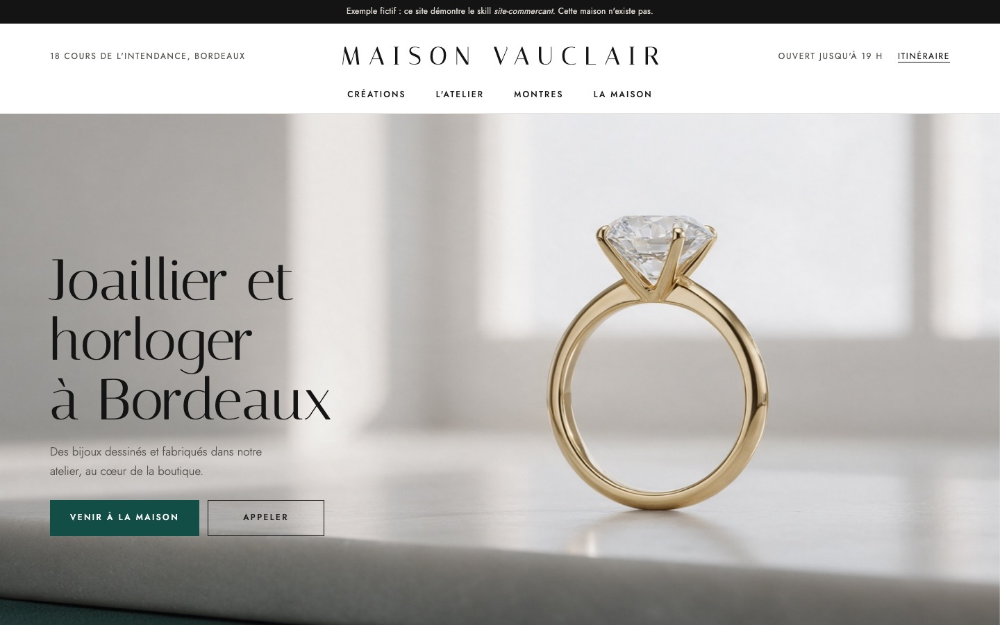
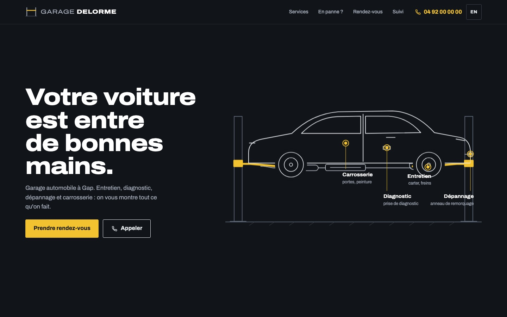

# Site Commerçant

[Français](README.md) · **English**

**A professional, fully personalised website for small shops and craftspeople, without paying an agency.**

### ▶ [See the live demos](https://mamyrva.github.io/site-commercant/en.html)

Run a bakery, a garage, a hair salon, a restaurant, a jewellery shop, a boutique, or a craft business? This project lets [Claude Code](https://claude.com/claude-code) build your website **with you, from start to finish**, the way an agency would.

| Bakery | Jewellery shop | Garage |
|---|---|---|
|  |  |  |
| Gold-on-brown poster, built from a reference style sheet | Understated luxury, jeweller's line drawings in place of photos | Animated car lift, repair tracking, FR/EN |

*All three are fictional examples built with this skill, and you can try them online. Photos are AI-generated illustrations. Sources are in [`exemples/`](exemples/).*

> **Language note:** the skill's instructions are written in French, and its legal layer covers **French law**. Claude talks to the shop owner in their own language. For a business outside France, the skill says so and adapts the legal part after checking local law.

---

## What you get

- 🗣️ **A real interview** about the business and the site the owner has in mind: the mood, sites they like, what makes the shop unique, the questions customers ask.
- 🎨 **Custom design** through [impeccable](https://impeccable.style). The owner picks between visual directions in their browser.
- ✨ **Animation** at the chosen level (calm, lively or spectacular), plus a **motion-design video** if wanted.
- ⚙️ **Features that actually work**: booking requests, quote forms, galleries, news, menus the owner can edit, order or repair tracking, multiple languages.
- 📱 **Mobile-first**, because that is where customers search.
- 📍 **Built for Google**:
  - structured data and a sitemap;
  - speed (Core Web Vitals);
  - an FAQ block, which also helps Google's AI answers;
  - a checklist for the Google Business Profile and Search Console.
- ⚖️ **Compliant in France**: legal notice, privacy page (GDPR), no tracking cookies.
- 💸 **Free hosting** (Netlify or GitHub Pages), with no subscription or maintenance.
- 🤝 **Nothing made up**: no fake reviews, prices or guarantees. Anything missing is clearly marked `[À COMPLÉTER]` ("to be completed").

## Requirements

- A computer (Mac, Windows or Linux).
- [Claude Code](https://claude.com/claude-code) with a Claude subscription.
- About 30 minutes, plus your photos if you have any.

## Install (once)

In Claude Code, run these commands one at a time:

```
/plugin marketplace add pbakaus/impeccable
/plugin install impeccable@impeccable
/plugin marketplace add mamyrva/site-commercant
/plugin install site-commercant@site-commercant
/reload-plugins
```

## Build a site

**Quick start:** describe the business in one sentence. Claude then asks its questions.

```
/site-commercant Bakery "Au Pain Doré" in Lyon, for families in the neighbourhood
```

**Full method:** fill in [`fiche-commerce.md`](fiche-commerce.md) (in French), put it in your working folder, then tell Claude:

```
Build my site from fiche-commerce.md
```

Claude runs the interview, shows visual directions, then builds and checks the site. At the end it hands over:
1. the list of missing details;
2. step-by-step free hosting instructions;
3. the Google checklist: Business Profile, Search Console and reviews.

## How it works

The skill lives in [`plugin/skills/site-commercant/`](plugin/skills/site-commercant/):
- `SKILL.md`: the steps Claude follows.
- `references/`: the interview, trades, features, motion, local SEO, French law, technical rules and deployment.
- `scripts/verifier.py`: an automatic site checker.

## An evolving project

This skill is **young and will keep evolving**. Every site built with it makes it better: each test adds rules, trades and checks. On the roadmap:

- more trades and examples;
- legal layers for Belgium, Switzerland and Canada;
- ready-made admin-panel setups, so owners can update their own content;
- motion-design presentation videos with HyperFrames;
- adding real Google reviews automatically, with the owner's consent.

Changes are tracked in [CHANGELOG.md](CHANGELOG.md). Got an idea, a bug, or a trade to add? **Open an issue** or send a pull request. Contributions are welcome, in English or French.

> ⚠️ The legal templates are a starting point, not legal advice. Google's ranking guidance changes over time, and the skill flags what to re-check.

MIT licence.
