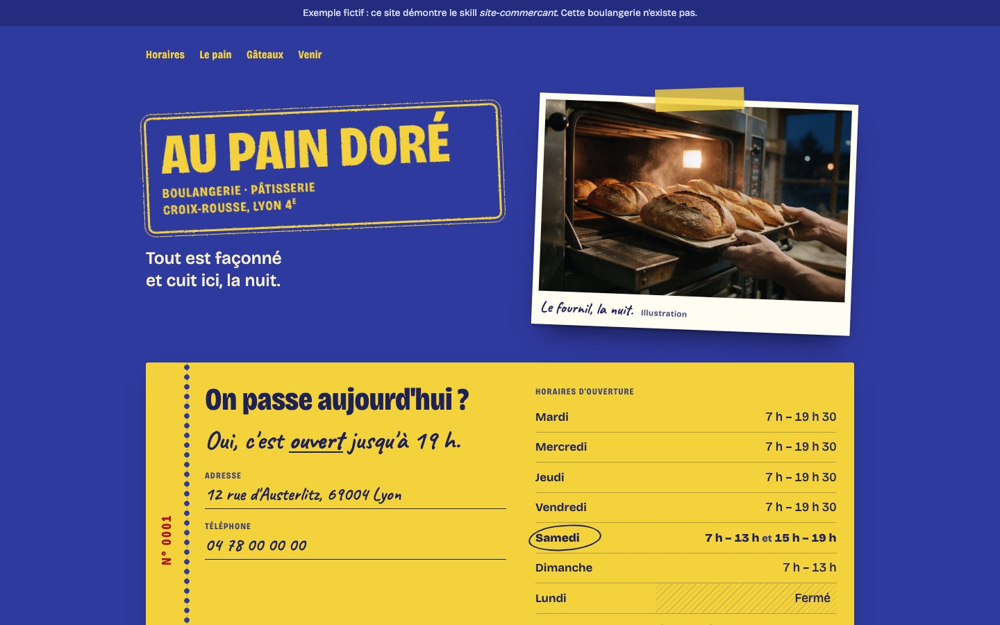
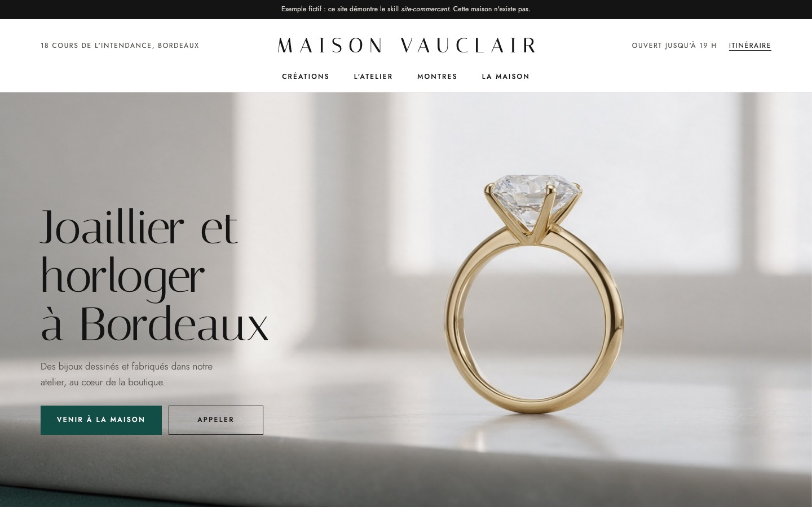
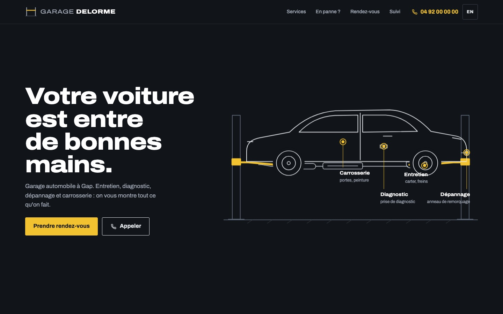

# Site Commerçant

**Français** · [English](README.en.md)

**Un site professionnel et personnalisé pour votre commerce, sans payer une agence.**

### ▶ [Voir les démos en ligne](https://mamyrva.github.io/site-commercant/)

Vous tenez une boulangerie, un garage, un salon de coiffure, un restaurant, une bijouterie, une boutique, ou vous êtes artisan ? Ce projet permet à [Claude Code](https://claude.com/claude-code) de créer votre site **avec vous, de A à Z**, comme le ferait une agence.

| Boulangerie | Bijouterie | Garage |
|---|---|---|
|  |  |  |
| Univers « carnet de commandes », bon de commande de gâteau | Luxe sobre, dessins de bijoutier à la place des photos | Pont élévateur animé, suivi de réparation, FR/EN |

*Ces trois sites sont des exemples fictifs, créés avec ce skill, et on peut les essayer en ligne. Les photos sont des illustrations générées par IA. Les sources sont dans [`exemples/`](exemples/).*

---

## Ce que vous obtenez

- 🗣️ **Un vrai entretien** sur votre commerce et votre idée du site : l'ambiance, les sites que vous aimez, ce qui rend votre commerce unique, les questions que vos clients vous posent.
- 🎨 **Un design sur mesure** grâce à [impeccable](https://impeccable.style). Vous choisissez entre plusieurs pistes visuelles, directement dans votre navigateur.
- ✨ **Des animations** au niveau que vous choisissez (sobre, animé ou spectaculaire), et une **vidéo en motion design** si vous le souhaitez.
- ⚙️ **Des fonctions qui marchent vraiment** : prise de rendez-vous, demande de devis, galerie, actualités, carte ou menu que vous modifiez vous-même, suivi de commande, plusieurs langues.
- 📱 **Parfait sur téléphone**, là où vos clients vous cherchent.
- 📍 **Pensé pour Google** :
  - données structurées et sitemap ;
  - vitesse (Core Web Vitals) ;
  - questions fréquentes, utiles aussi pour les réponses de l'IA de Google ;
  - une checklist pour votre fiche Google Business Profile et la Search Console.
- ⚖️ **En règle en France** : mentions légales, confidentialité (RGPD), aucun cookie espion.
- 💸 **Hébergement gratuit** (Netlify ou GitHub Pages), sans abonnement ni maintenance.
- 🤝 **Rien d'inventé** : ni faux avis, ni faux prix, ni fausses garanties. Ce qui manque est clairement marqué `[À COMPLÉTER]`.

## Ce qu'il vous faut

- Un ordinateur (Mac, Windows ou Linux).
- [Claude Code](https://claude.com/claude-code), avec un abonnement Claude.
- 30 minutes, et vos photos si vous en avez.

## Installation (une seule fois)

Dans Claude Code, tapez ces commandes une par une :

```
/plugin marketplace add pbakaus/impeccable
/plugin install impeccable@impeccable
/plugin marketplace add mamyrva/site-commercant
/plugin install site-commercant@site-commercant
/reload-plugins
```

## Créer votre site

**Méthode rapide :** décrivez votre commerce en une phrase. Claude vous pose ensuite ses questions.

```
/site-commercant Boulangerie « Au Pain Doré » à Lyon, pour les familles du quartier
```

**Méthode complète :** remplissez [`fiche-commerce.md`](fiche-commerce.md), mettez-la dans votre dossier de travail, puis dites à Claude :

```
Crée mon site à partir de fiche-commerce.md
```

Claude mène l'entretien, vous montre des pistes visuelles, construit et vérifie le site, puis vous donne :
1. la liste des informations à compléter (SIRET, horaires…) ;
2. la marche à suivre pour le mettre en ligne gratuitement ;
3. la checklist Google : fiche Google Business Profile, Search Console, avis.

## Comment ça marche

```
plugin/skills/site-commercant/
├── SKILL.md                    ← les étapes que suit Claude
├── references/
│   ├── entretien.md            ← les questions à poser au commerçant
│   ├── questionnaire.md        ← les informations pratiques + modèle PRODUCT.md
│   ├── metiers.md              ← pages et pièges par métier
│   ├── fonctionnalites.md      ← réservation, devis, galerie, suivi, contenu modifiable…
│   ├── motion.md               ← animations et vidéos en motion design
│   ├── seo-local.md            ← référencement Google (mis à jour en 2026)
│   ├── legal-fr.md             ← obligations légales françaises
│   ├── structure-site.md       ← règles techniques
│   └── deploiement.md          ← mise en ligne gratuite
└── scripts/verifier.py         ← vérification automatique du site
```

## Un projet qui évolue

Ce skill est **jeune et va continuer d'évoluer**. Chaque site créé le rend meilleur : chaque test ajoute des règles, des métiers et des vérifications. Ce qui est prévu :

- de nouveaux métiers et de nouveaux exemples ;
- une version des obligations légales pour la Belgique, la Suisse et le Canada ;
- des modèles prêts à l'emploi pour l'interface d'administration (mise à jour du contenu par le commerçant) ;
- des vidéos de présentation en motion design avec HyperFrames ;
- l'ajout automatique des avis Google réels, avec l'accord du commerçant.

Les changements sont notés dans [CHANGELOG.md](CHANGELOG.md). Une idée, un bug, un métier à ajouter ? **Ouvrez une *issue*** ou proposez une *pull request*. Toutes les contributions sont bienvenues.

> ⚠️ Les modèles de mentions légales sont un point de départ, pas un conseil juridique. En cas de doute, demandez à votre CCI, à votre CMA ou à votre comptable. Les règles de référencement de Google changent régulièrement : le skill indique ce qu'il faut revérifier.

Licence MIT.
